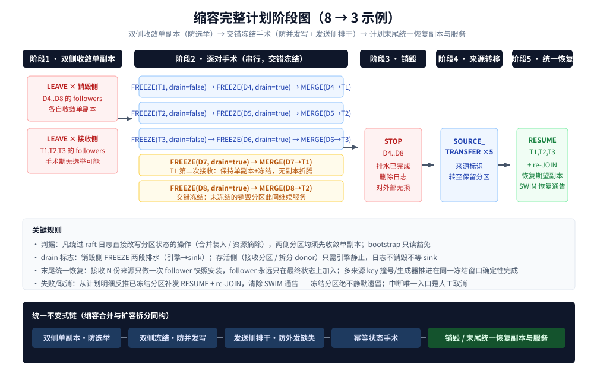

# 数据手术设计：冻结排水与合并拆分

> 模块：`kunpeng/cluster/cluster-dispatch`（编排侧）+ broker/bpmn-engine/eventlog（执行侧）。
> 上游设计：[01-cluster-dispatch-design.md](./01-cluster-dispatch-design.md)、[02-cluster-dispatch-detail.md](./02-cluster-dispatch-detail.md)。
> 本文定义缩容合并与扩容拆分两类数据手术的完整不变式链：**双侧单副本（防选举）→ 双侧冻结（防并发写）→
> 发送侧排干（防外发缺失）→ 幂等状态手术 → 发送侧销毁 / 计划末尾统一恢复副本与服务**。

---

## 1. 问题定性（改造前缺陷）

| # | 缺陷 | 根因 |
|---|------|------|
| 1 | 未导出尾部缺失 | sink 从事件日志异步拉取外发（位点独立记账），DATA_MERGE→STOP 链路无任何位点检查；`stopAndDelete` shutdown 后直接删除分区目录（日志+RocksDB），`(sink 确认位, 日志末位]` 的记录对外部消费者永久缺失 |
| 2 | 日志结构性不搬 | `takeMergeSnapshot` 仅从最近 raft 镜像拷 `PROCESS_POSITION` 一个列族；被缩分区历史记录在保留分区不存在任何可导出形态 |
| 3 | merge 位点后写入窗口 | 计划明细序为"全部 MERGE → 全部 STOP"，merge 完成到 STOP 之间源分区仍在拓扑可路由，新写入既不进合并状态也不被导出，彻底丢失 |
| 4 | 选举转移风险 | 合并安装直接写接收分区 Leader 的 RocksDB（绕过 raft 日志，日志只追加标记条目），手术窗口内接收分区若发生选举，新 Leader 重放日志无手术数据 → 丢失/分歧 |

四条缺陷的共同解法不是搬日志（排水先行让历史记录在销毁前完整送达外部，保留分区只需状态续跑），
而是让手术发生在"双侧单副本、双侧静止、发送侧已排干"的确定性窗口内。

---

## 2. 三类数据转移场景

| 场景 | 通道 | 接收侧等待 | 单副本收敛 |
|------|------|-----------|-----------|
| 引导新分区（扩容 BOOTSTRAP） | 引导镜像（`takeBootstrapSnapshot` 对 donor **只读**拷 DEPLOYMENT 列族） | 新分区为空，无需等待 | **豁免**：donor 只读不动状态；新分区安装时天然单成员（follower 装后 JOIN） |
| 删除分区合并（缩容 DATA_MERGE） | 合并镜像（`takeMergeSnapshot` → 推送 → 两阶段安装） | 接收分区冻结至引擎静止 | **双侧**：销毁分区与接收分区均收敛单副本 |
| 资源拆分（扩容 resourceId 代理拆分） | 按 resourceId 拆分镜像（`ResourceDataSplit.splitLocalFamilyData` 载荷机制，逐列族按资源抽取） | donor 冻结至引擎静止；新分区空 | **双侧**：donor 收敛单副本；新分区天然单成员 |

单副本收敛的**本质判据**：凡绕过 raft 日志直接改写分区 RocksDB 状态的操作（装入/摘除），涉及的
**两侧**分区都必须先收敛为单副本——单成员 raft 组不可能发生领导转移，手术写入不存在被选举吞掉的窗口；
同时冻结保证手术期间该 RocksDB 的唯一写者就是手术本身（key 生成器推进、跨分区 key 撞号处理等载荷
工作获得确定性施工环境）。只读搬运（bootstrap）豁免。

---

## 3. FREEZE / RESUME 命令语义

### 3.1 冻结定义

**停一切写者，保一切读者**。冻结对象 = 事件日志（EL）的写者集合归零，不是停服务：

| 写者 | 入口 | 冻结动作 |
|------|------|---------|
| 外部用户命令 | `CommandApiHandleImpl` → `tryAppend(USER_COMMAND)` | 拒绝（PARTITION_FROZEN 可重试错误码） |
| 跨分区命令 | `InterPartitionCommandReceiverImpl` → `tryAppend(INTER_PARTITION)` | 拒绝（同上；该处已有 diskSpaceAvailable 拒绝样板） |
| 内部触发（定时器/job 超时/分发/历史清理） | checker 家族（`logEventWriter.schedulerCheckerAwares()` 注册表） | `onPaused()`（钩子已预留，逐 checker 落实现） |
| 引擎处理写入（自驱后续命令链） | `EngineProcessService` 处理循环 | **不停，跑干**（见 3.2） |

读者（sink 导出、跑干期的处理循环）全部保留。冻结标志挂在 EventLogWriter 层按 `WriteContext`
过滤：冻结期拒绝 USER_COMMAND / INTER_PARTITION，放行引擎处理写入；引擎静止后写者自然归零。

**为什么"停业务流转"必须拆两半**：产生新工作（入口+checker 触发）立刻停；已在途的工作（已写入 EL 的
COMMAND，含引擎自驱的后续命令链——业务链是穿过日志推进的）必须消费完。pending 命令只存在于日志、
不存在于状态，merge 只搬状态——不跑干则半截业务永久卡死。静止判定 = **EL 无未处理 COMMAND 且无新触发**。

**为什么停 checker 是安全的**：checker 是扫描器模式（内存只存下次扫描时间，业务本体如定时器 dueDate
全在仓库列族持久化），到期未触发只是留在状态里等待补触发；`onResumed → schedule(-1)` 重扫仓库即补。
前提：合并载荷必须包含这些列族（见 §7 载荷清单）。

### 3.2 两段排水（FREEZE 内部状态机）

```
关入口(USER_COMMAND/INTER_PARTITION) + checker 家族 onPaused     ← 瞬时
  ↓
第一段·引擎排水：等 processedPosition == EL 写入末位
  （消费完在途命令链 + EL 追加管线排空）→ 此刻 final 确定
  ↓
第二段·sink 排水：等 min(所有 sink 确认位点) == final            ← 仅 drain=true
  ↓
ack 调度系统
```

- **drain 标志两类冻结**：销毁侧（dying）`drain=true` 两段全等；存活侧（接收分区/donor）
  `drain=false` 只需第一段（其日志不销毁，无需等 sink）。
- **位点全部现成**：引擎侧 `processPosition`（`ProcessedPositionRepository`，随处理事务落库）；sink 侧
  `sinkPositionSupplier`（全部 sink 最低确认位，repository 直读）——与 raft 快照元数据
  `PROCESS_POSITION` / `SINK_POSITION` / 压缩门槛 `getCompactionFloorPosition` 同源同 supplier。
- **顺序不可反**：final 在引擎静止前是移动靶，sink 排水必须以确定的 final 为目标。
- **"EL 写入末位"含追加管线排空**：eventlog append 管线（无锁定序器 + EL 批帧）在途帧必须沉降后才可定 final。
- **无 sink 边界**：`sinkPositionSupplier` 为 -1（未装配 sink）时第二段排水条件视为立即满足（与压缩门槛
  的 -1 无约束语义一致）——无外部消费者即无排干义务。
- **sink 位点写入已实证带外**：`SinkSlot`/`SinkService` 经 `MutableSinkRepository` 直写 RocksDB，不产生
  EL 记录——排水条件无自引用循环，收敛性成立。
- **幂等与重启**：FREEZE 是首个长时明细，内部按阶段幂等（未冻结→执行冻结；冻结中→续等；已排干→重发 ack）；
  冻结标志持久化，重启经 `restartExecution` 重放恢复到正确阶段继续等。

### 3.3 RESUME 配对

```
RESUME:
  1. schedulerCheckerAwares().forEach(onResumed)   ← 重扫仓库补触发到期未触发事件
  2. 开入口（清除 writer 冻结过滤）
  3. 清除 SWIM 通告（分区恢复 ACTIVE）
```

RESUME 必须与失败/取消路径严格配对：冻结后取消计划若不恢复 = 死分区。计划取消/FAILING 处理器从计划
明细反推已冻结分区，补发 RESUME + re-JOIN。

---

## 4. 缩容完整计划序列

以 8→3 为例（保留 1,2,3；销毁 4..8；合并映射 `kept[i % keptCount]`：4→1、5→2、6→3、7→1、8→2）：

```
阶段1  双侧收敛单副本：
       LEAVE(D4..D8 的 followers) + LEAVE(T1,T2,T3 的 followers)
阶段2  逐对手术（串行，交错冻结）：
       FREEZE(T1,drain=false) → FREEZE(D4,drain=true) → MERGE(D4→T1)
       FREEZE(T2,drain=false) → FREEZE(D5,drain=true) → MERGE(D5→T2)
       FREEZE(T3,drain=false) → FREEZE(D6,drain=true) → MERGE(D6→T3)
       FREEZE(D7,drain=true) → MERGE(D7→T1)        ← T1 第二次接收，保持单副本+冻结不折腾
       FREEZE(D8,drain=true) → MERGE(D8→T2)
阶段3  STOP(D4..D8)
阶段4  SOURCE_TRANSFER ×5
阶段5  RESUME(T1,T2,T3) + re-JOIN followers 恢复期望副本   ← 计划末尾统一做
```

- **销毁分区冻结交错、不前置**：未冻结的销毁分区在别的分区手术期间继续服务，可用性渐进流失；
  全量前置冻结会让所有 keyspace 同时停服。
- **只收敛命中合并映射的接收分区**：接收分区 = `kept[i % keptCount]` 实际命中的保留分区（如 5→4
  仅 T1 命中）；未命中的保留分区不生成任何明细，全程不动——无谓的收敛/恢复只徒增停服窗口与副本折腾。
- **计划末尾统一恢复副本**：一次"恢复副本"= 每 follower 一次 raft 配置变更 + 一次全量快照安装；
  接收分区接收 N 份来源若逐份恢复要折腾 N 轮。末尾一次恢复，follower 只在**最终状态**上加入，
  永远看不到手术中间态；多来源累积手术（key 撞号、生成器 max 推进）在同一冻结窗口内确定性完成。
  该形态在现有串行明细模型内零生命周期改动（普通明细追加在计划尾部）。
- **RESUME 必须先于 re-JOIN（领导确定性）**：调度明细在计划生成时指定执行节点（FREEZE/MERGE/STOP/
  SOURCE_TRANSFER/RESUME 均发给分区 Leader）。整个手术窗口保持单副本正是为了保证 Leader 不变——
  一旦先恢复多副本，追平的 follower 可能当选，后续 RESUME 明细的执行节点就指向了旧 Leader。
  RESUME 在仍单副本时执行（Leader 与计划指定一致），随后 re-JOIN——JOIN 明细发给**加入方 follower
  本人**、不依赖 Leader 身份，恢复副本后 Leader 再漂移也无碍。
- **执行侧既有语义核对**（复用 LEAVE/JOIN 摘挂保留分区 follower 的依据）：`TopologyManager` 只维护
  本节点托管视图（removePartition 移除本节点条目后重播成员属性，集群视图由各成员属性汇总，leader 仍在
  即分区仍在）；`handleJoin` 对本地不存在的分区走 `BusinessPartitionService.joining().start()` 加入既有
  raft 组（与 bootstrap 的 follower JOIN 同路径），成功后 `addPartition` 回填本地配置——LEAVE/JOIN
  的本地记账对称闭合。



---

## 5. 扩容资源拆分序列（resourceId 复用）

场景：分区 P 代理（agent）资源 1、2；扩容新增分区 N 时为 resourceId 复用，把资源 1 的数据从 P 拆出
合并进 N，资源 1 的来源标识转移给 N（`BOOTSTRAP_SOURCE_DATA_TRANSFER` 的正式形态）。

```
LEAVE(P 的 followers)                      ← donor 收敛单副本
FREEZE(P, drain=false)                     ← donor 静止
SPLIT_PUSH(P→N, resourceId=1)              ← 按 resourceId 拆分推送安装（payload 见 §7）
REMOVE(P, resourceId=1)                    ← 【删除】安装确认后删除 donor 内被移走的数据（见下）
SOURCE_ID_TRANSFER(resourceId 1: P → N)    ← 来源归属挪移 + 拓扑广播
RESUME(P)                                  ← 仍在单副本时执行（Leader 与计划指定一致，见 §4 领导确定性）
re-JOIN(P followers)                       ← 计划末尾统一恢复副本
```

- 冻结顺带解决拆分的路由竞态：冻结期发给 P 的命令被拒，解冻时拓扑已宣告资源 1 归 N。
- 新分区 N 天然单成员，同 bootstrap 豁免。
- 拆分载荷机制已备：`ResourceDataSplit.splitLocalFamilyData(resourceId, visitor)` 逐列族按资源抽取，
  `DataSplitRegister` 已挂全部 repository 构造；缺的是本节编排。

**删除被移走数据是正确性要求，不是空间优化**：现有 `splitLocalFamilyData` 全部实现是只读扫描
（`forEach` + visitor），split 路径没有删除对应物。若 donor 保留被移走的数据行：RESUME 后 donor 的
checker 家族重扫仓库（如 `TimerDueDateChecker` 扫 TIMER 列族）会把**已归属 N 的定时器重新挂上并触发**，
产生双重触发与状态分歧；流程实例、变量等行同理成为幽灵数据。删除约束：

- **时序**：安装确认成功**之后**才删（先推送后删除，失败重试安全：数据仍在 N，donor 重删幂等）；
- **位置**：在 donor 冻结+单副本窗口内执行（对 donor RocksDB 的又一次绕过日志的直接改写，同属手术）；
- **载荷**：`ResourceDataSplit` 需补删除变体（逐 key 删除，或利用 resourceId 编码在 key 高位、
  同资源 key 天然连续的特性做区间删除）。

---

## 6. SWIM 通告层（分区不可见性广播）

**通告是建议层，权威在分区自身**——两层分离，通告绝不承担正确性：

| 层 | 载体 | 职责 | 性质 |
|----|------|------|------|
| 权威层 | 分区 writer 级 WriteContext 拒绝 | 正确性（冻结期一条都进不来） | 强制，不依赖收敛 |
| 通告层 | SWIM 拓扑状态 | fail-fast、流量规避、可观测 | 建议，错过收敛窗口无害（送到的命令被权威层拒） |

- **落点**：broker 唯一传播实体 `TopologyManager`——FREEZE handler 执行时在拓扑实体标记分区状态
  （`PartitionInfoMetaRecord` 增 `STATE`：ACTIVE/FROZEN）并 `publishBroadcast()`；RESUME/STOP 清除再广播。
  搭车 SWIM 元数据通道（版本 + METADATA_CHANGED + owner 直拉 + 周期反熵），万级收敛 ~3s、稳态零流量。
- **FREEZE 的 ack 绝不等 SWIM 收敛**（最终一致无完成语义）。
- **陈旧窗口方向性**：广播滞后（已冻当 ACTIVE）无害——权威层兜住；广播过期（已恢复当 FROZEN）有害——
  由状态机确定性封住（FROZEN 只经 FREEZE 明细进入、只经 RESUME/STOP 退出，全走 admin 日志可重放，
  重启 replay 重发布），窗口上界 = SWIM 收敛时间。
- **消费者**：网关命令路由见 FROZEN 直接回 `PARTITION_FROZEN`（可重试，映射到客户端错误码）；网关
  job hub 激活探测跳过冻结分区；跨分区命令发送方本地 fail-fast；监控分区状态 gauge + 冻结时长告警。

---

## 7. 合并/拆分载荷清单

改造前合并仅搬 `PROCESS_POSITION`（处理位点一个数字）。手术窗口内（双侧冻结单副本）载荷必须扩到
**全部 LOCAL 列族**，至少包括：流程实例（processinstance）、活动实例（activityinstance）、变量
（variable）、定时器（timer）、job（job）、异步（async）、批次（batch）、延迟（delay）、incident、
消息/信号订阅、key 生成器（KEY / RESOURCE_MAX——接收方生成器 max 必须越过被合并方已用最大值）。
GLOBAL 列族（部署/定义类）不随合并搬运（各分区本就全量持有）。拆分场景按 resourceId 过滤同清单。

---

## 8. 看门狗长时明细协议

现有看门狗是**活跃度重试探**（到期未终态 → 重发明细 EXECUTING → 处理器再注册看门狗，循环自持），
不是超时杀手。长时明细（FREEZE 排水、MERGE/SPLIT 传输）在此之上升级为"询问 + 进度回报"：

- **执行侧**：长时明细 handler 一律幂等状态机 + 在飞守卫（重发 EXECUTING 到达时：未开始→正常执行；
  进行中→不重入，回 `IN_PROGRESS` ack 附进度（阶段+当前位点/最终位点）；已完成→重发 SUCCEED ack）。
  DATA_MERGE 补在飞守卫防两个 `pushDataMerge` 并发重入。
- **调度侧**：Acknowledge 处理器识别 `IN_PROGRESS` → 不置终态、维持看门狗循环，进度附着明细记录
  （可查询、喂指标）。重试探即询问，IN_PROGRESS 即续期，租约自动延。
- **永不自动中断**：① 排水慢 ≠ 失败（外部 sink 卡几小时排水就该等几小时；时间预算中断会把健康等待
  变成全集群冻结-恢复折腾）；② MERGE 传到一半不可安全抢占，安全中断点只在明细间隙 = 人工取消路径；
  ③ 时间预算自动回退违反"禁止兜底"。
- **中断唯一入口 = 人工取消计划**（CANCELING → 恢复编排）。配套观测：poke 计数、冻结时长 gauge、
  排水进度（final − sink 位差值）+ 告警阈值；是否设"最大冻结时长超限转 FAILING"策略旋钮默认**不设限
  只告警**，超限处置交人工。
- **成员死亡**：无 ack、poke 空转；成员回归 `restartExecution` 重放在飞调度从冻结标志续跑；永久死亡
  = 人工取消。

---

## 9. 失败、取消与恢复编排

- 明细失败语义不变：失败 ACK → 延迟重试不终止计划；FREEZE/MERGE 的长等待由 IN_PROGRESS 续期承接。
- **计划互斥（手术窗口的前置闸门）**：类型入口处理器现无"存在未完结计划"守卫，且 `oldMeta` 取自
  `getClusterMeta()`（仅计划完结时更新）——手术进行中再提交新计划会拿**手术前旧拓扑**做 diff，与在途
  手术互相破坏（对已收敛单副本/已冻结分区再发 LEAVE/MERGE）。手术窗口拉长至分钟级后此暴露被显著放大，
  必须补：business 三类入口命令在存在非终态计划时拒绝（"有未完结调度计划"错误响应）或排队；仓库侧需
  支持非终态计划查询（按 state 遍历或维护在途标志）。
- 计划取消/FAILING：从计划明细反推已冻结分区与已摘除 follower 的分区，逐个补发 RESUME + re-JOIN，
  清除 SWIM 通告——冻结分区绝不允许静默遗留。
- 观测三件套：分区状态 gauge（ACTIVE/FROZEN）、冻结时长 timer、计划级挂起告警（有指标必有面板，
  见 monitor-dashboards 技能）。

---

## 10. 已知代价（有意取舍）

| 代价 | 说明 |
|------|------|
| 接收分区停服窗口 | 从其第一次合并前冻结到计划末尾恢复，接收分区 keyspace 不可用；窗口 = 计划内全部排水+手术时长（排水在背压约束下滞后有界） |
| 迁移实例延迟 | 冻结期到期的定时器/job 超时延迟至目标分区/donor 恢复后补触发（扫描器模式保证不丢只延迟） |
| 手术期容错降级 | 双侧单副本期间无 raft 冗余；成员崩溃等待重启续跑（数据在本地盘），永久损坏 = 人工取消 |
| 历史流分区切分 | 拆分实例的历史记录在 donor、后续记录在新分区，外部消费者按 (partition, position) 记账天然兼容 |

---

## 11. 协议与工程落点清单

| 项 | 位置 | 说明 |
|----|------|------|
| FREEZE / RESUME 执行类型 | protocol-admin `PartitionExecutionType` 追加 `FREEZE(11)` / `RESUME(12)` | 追尾号不重排；topic = `BUSINESS-FREEZE` / `BUSINESS-RESUME` |
| 冻结/恢复明细记录 | protocol-admin-impl `record/command/common/` 新增 `PartitionFreezeRecord` / `PartitionResumeRecord` | 含 drain 标志；structpack key-id 身份管理，wrap/unwrap 成对 |
| ack 进度状态 | `PartitionExecutionAckRecord` 增 `IN_PROGRESS` 语义（state 字段或等价） | 枚举加值必须审计全部 switch（from/fromValue 漏 case 教训） |
| 拓扑分区状态 | `PartitionInfoMetaRecord` 增 `STATE` 属性（ACTIVE/FROZEN） | 协议变更走 structpack 流程；SWIM 通告与网关消费同源 |
| 执行侧 handler | broker `ClusterBusinessService` 增 handleFreeze/handleResume + `restartExecution` 补 case | 冻结标志持久化；幂等状态机；**校验本成员为该分区 Leader**（同 `pushDataMerge` 的角色守卫——防计划拓扑视图时滞导致明细发往旧 Leader，失败走既有重试链） |
| 计划互斥 | business 三类入口命令在存在非终态计划时拒绝/排队（§9） | 手术窗口前置闸门，现有入口无守卫 |
| 代理路由 | 迁移实例/job 的命令与激活路由经 agent 映射到接收分区（网关消费拓扑 agent 信息） | 缩容后源分区拓扑摘除，迁移 job 若仍按原分区路由则不可达 |
| writer 冻结过滤 | eventlog `EventLogWriter` 按 WriteContext 过滤 + `AppendResult.Rejected` | 一处收口全部写者 |
| checker 暂停 | bpmn-engine 五个 checker（Timer/JobTimeout/DistributeParallel/DistributeSerial/HistoryCleanup）实现 `onPaused`/`onResumed` | 接口钩子已预留；逐个盘点补齐 |
| 引擎跑干挂点 | `EngineProcessService` 增 quiesce 通知（reader 追平 writer 且 checker 已暂停时完成 future） | sink 侧无需新增（位点外部可读） |
| 计划生成器 | `ChangePartitionDispatchPlanGenerator.createScaleDownPlan` 按 §4 重排；扩容生成器补拆分明细 | 末尾统一 RESUME + re-JOIN |
| 合并载荷 | `BusinessRaftSnapshotProvider.takeMergeSnapshot/doMerge` 扩列族清单（§7） | 手术窗口内确定性施工 |
| 拆分执行 | SPLIT_PUSH 明细单执行覆盖"抽取→推送→安装确认→**删除 donor 被移走数据**"全链（同 `pushDataMerge` 拍-推-确认-清理一体模式，幂等重试） | 删除时序见 §5：安装确认之后才删 |
| 拆分载荷删除 | `ResourceDataSplit` 补删除变体（逐 key 或按 resourceId key 区间——resourceId 编码在 key 高位、同资源 key 连续） | 现有实现全部只读扫描，无删除对应物 |
| 恢复顺序 | RESUME 先于 re-JOIN（§4 领导确定性）；生成器已按此排序 | JOIN 发给 follower 本人，不依赖 Leader 身份 |
| 看门狗 | business/admin 明细 Acknowledge 处理器增 IN_PROGRESS 分支 | 进度附着明细 |
| 网关 | PARTITION_FROZEN 错误码 → 可重试客户端错误映射；job hub 探测跳过冻结分区 | 通告层消费 |
| 监控 | 分区状态/冻结时长/排水进度指标 + 面板 | monitor-dashboards 五步流程收口 |

---

## 12. 实施顺序建议

1. 协议层（执行类型、记录、ack 状态、拓扑 STATE）；
2. 执行侧冻结核心（writer 过滤、checker onPaused、quiesce 挂点、FREEZE/RESUME handler、restartExecution）；
3. 缩容计划生成器重排 + 看门狗 IN_PROGRESS；
4. 合并载荷扩列族；
5. SWIM 通告 + 网关消费；
6. 扩容拆分编排（SPLIT_PUSH 明细 + ResourceDataSplit 接线）；
7. 指标与面板、测试矩阵（冻结幂等/重启 replay/取消恢复/排水进度）。
