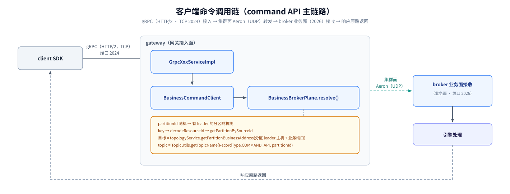
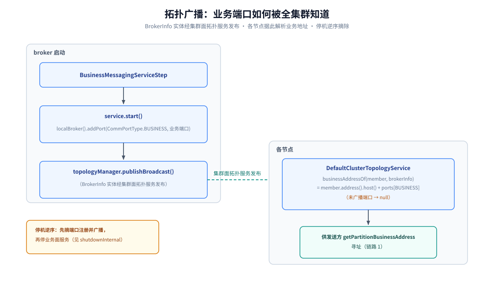

# Kunpeng 集群通信体系（cluster-messaging）

节点间通信的总纲：三个网络平面各管什么、消息 API 分几层、一条消息怎么从 A 走到 B、新功能该用哪个协议开发什么接口。wire 帧格式与 Aeron 参数细节在 [01-transport-wire.md](./01-transport-wire.md)。

## 三平面总览

| 平面 | 配置前缀 | 默认端口 | 协议 | 承载组件 | 启动播报日志 |
|---|---|---|---|---|---|
| 集群面（membership） | `kunpeng.cluster.network.*` | 2025（`cluster.start-port`） | Aeron（可靠 UDP） | `AtomixCluster` → `AeronMessagingService` + `AeronUnicastService`（共享同一端口，双逻辑流） | `Membership messaging started on port 2025 (aeron-udp)` |
| 业务面（business/raft） | `kunpeng.broker.network.*` | 2026（start-port+port-offset） | Aeron（可靠 UDP） | broker 侧独立 `AeronMessagingService`（`BusinessMessagingServiceStep`） | `Business messaging started on port 2026 (aeron-udp)` |
| 网关接入面（gRPC） | `kunpeng.gateway.network.*`（独立）/ `kunpeng.broker.gateway.network.*`（内嵌） | 2024 | gRPC（HTTP/2，TCP） | `GatewayGrpcService`（内嵌与独立网关同一组件、各自配置树） | `gRPC server started on port 2024 (grpc-tcp)` |

另有 HTTP（REST/OpenAPI，8080）与 Actuator（9600）由 Spring Web（Netty）自行播报 `Netty started on port ... (http)`。`dist/README.md` 端口表与本表同源。

三条铁律：

- **节点间一切消息都是 UDP**（Aeron）。集群内没有节点间 TCP 连接；"可靠" = Aeron 流控重传，"不可靠" = `UnicastService` 裸 UDP 语义。`ClusterCommunicationService` javadoc 里的 "TCP/UDP" 是语义标注，不是实际传输协议。
- **业务面只收不发**：只有 broker 启动业务面接收端（命令接收与集群面 Raft 流量隔离）；发送方（gateway 或 broker 的 `BrokerClient`）复用**集群面** Atomix 通信组件，直接向"目标成员主机 + 业务端口"寻址。
- **同进程双实例各自独立底座**：broker 进程内集群面与业务面各持一个 `AeronTransport`（独立代理线程/队列/socket/内嵌驱动）——驱动刻意不共享，避免快照复制风暴与业务命令路径争用同一条驱动网络线程（共享也是跨实例 ipc 的前提，该路线已定性放弃）；refcount 管理各自生命周期，同 JVM 多节点测试互不影响。

## 寻址模型

| 要发往 | 解析方式 |
|---|---|
| 某成员 | `ClusterCommunicationService` 按 `MemberId`，内部经 membership 解析为集群面 `Address` |
| 某业务分区 leader | `ClusterTopologyService.getPartitionBusinessAddress(partitionId)` = leader 成员的**成员地址主机**（`member.address().host()`）+ 其拓扑广播的**业务端口**（`BrokerInfo.ports[CommPortType.BUSINESS]`） |

业务地址三者任一未就绪（leader 未选出 / 成员离线 / 端口未广播）即返回 `null`，发送方立即抛错——不做兜底重试。subject = 路由键（全集群唯一字符串），携带在帧内，接收端按 subject 分发 handler。

## 消息 API 四层（自底向上）

| 层 | 接口 | 寻址 | 核心方法 | 何时用 |
|---|---|---|---|---|
| 1 | `MessagingService` | `Address` | sendAsync / sendAndReceive / registerHandler（可靠流） | 绕过 membership 直连地址（少用） |
| 2 | `UnicastService` | `Address` | unicast / addListener（不可靠单向） | 低价值高频、可容忍丢失 |
| 3 | `ClusterCommunicationService` | `MemberId` | send(带超时) / replyTo / replyToAsync / consume / unicast / multicast / broadcast(reliable 开关) / unsubscribe | **默认开发入口**：节点间请求-应答与通知 |
| 4 | `ClusterEventService` | 订阅式 | publish / subscribe | 集群范围发布-订阅广播 |

现有消费方：Raft（复制/快照/领导转移）、broker admin、broker business（raft step transition）、gateway gRPC（cluster manage）、job 流（PUSH/READY）。

## 典型调用链路

### 1. 客户端命令（command API 主链路）

要点：`BusinessBrokerPlane` 只处理 `COMMAND_API` / `QUERY` 两类请求类型；地址不可解析立即抛 `BrokerException`。

### 2. job 推拉（`JobStreamSubjects`）

- `job-stream-push`（B→GW，请求-应答 PushResult）：推送失败发送端就地可知，本地写 WITHDRAW 回退命令——无反向失败主题
- `job-ready`（B→GW 广播，fire-and-forget，载荷仅 jobType 名）：唤醒挂起的长轮询
- 订阅快照**不走消息主题**：写网关本地成员属性 `job-stream-snapshot`（SBE 帧 base64），随 SWIM 元数据通道（版本反熵 + owner 直拉）扩散
- 其余 job 命令（拉取/完成/失败）一律走标准 commandapi 通道（链路 1）

### 3. 拓扑广播（业务端口如何被全集群知道）

### 4. Raft 复制

每分区一组 subject（`RaftMessageContext` 按 group-partition 名派生）：append-v1/append-v2、vote、configure/reconfigure/forceConfigure、join/transfer、timeoutNow、leadershipTransfer 等。`RaftServerCommunicator` 全部经 `ClusterCommunicationService.send/replyTo` 走**集群面**；超时分档（request / snapshot / configurationChange）。

### 5. SWIM 成员

membership（`DefaultClusterMembershipService` + `GroupMembershipProtocol`）：周期探测（probe-timeout 100ms 等 10 个参数，`kunpeng.cluster.membership.*`）+ gossip 反熵 + 成员属性同步（承载 job 订阅快照等）。全走集群面 transport。

## 开发指引

### 新增一条集群消息（subject）

1. 定 subject：全局唯一字符串；参考 `JobStreamSubjects` 建**专用常量类**，勿塞公共常量类
2. 定编解码：优先复用既有 SBE / Serializer namespace；新消息类型注册到专用 namespace
3. 接收方注册：`ClusterCommunicationService.replyTo`（请求-应答，可拿发送方 MemberId）或 `consume`（单向）；**handler 必须轻**——运行在通信代理线程或指定 executor 上，长活转交 actor（见 `scheduler` 技能）
4. 发送方：请求-应答用 `send(subject, msg, encoder, decoder, memberId, timeout)`；单向用 `unicast/multicast/broadcast`（reliable 开关选可靠流或不可靠 UDP）
5. 清理：关闭路径 `unsubscribe(subject)`

### 新增一个 gRPC 接口

1. proto：`kunpeng/gateway/gateway-protocol/src/main/proto/` 新增/扩展 service（现有 10 个：deployment / process_instance / job / user_task / message / signal / incident / variable / expression / cluster_manage）
2. 实现 `GrpcXxxServiceImpl implements GrpcService`（gateway-grpc 模块，参考既有实现与 `GrpcErrorHandle`）
3. 注册：`GatewayGrpcService.createGrpcServices()` 加一行（内嵌与独立网关自动同时生效）
4. 若是引擎命令（需引擎执行/持久化）：按 `engine-chain` 技能的 11 项注册点走全链路（client SDK → gateway → broker → 引擎 → 存储）；纯集群管理类可直接用 `ClusterCommunicationService`（参考 `GrpcClusterManageServiceImpl`）
5. 客户端 SDK 同步补 client-java 方法

### 协议选择决策表

| 需求 | 用什么 |
|---|---|
| 客户端 ↔ 引擎 命令/查询 | gRPC（网关接入面，TCP 2024） |
| 节点 ↔ 节点 请求-应答 | `ClusterCommunicationService.send/replyTo`（集群面 Aeron UDP） |
| 投递命令到业务分区 leader | `BrokerClient` / `BusinessBrokerPlane`（发送走集群面，落到对端业务端口 2026） |
| 集群范围通知/事件 | `broadcast`/`multicast` 或 `ClusterEventService` |
| 低价值高频、可容忍丢失 | `UnicastService`（不可靠 UDP） |

## 硬规则与坑

- **subject 冲突 = 串消息**：路由键无命名空间强制隔离，新增前先全局 grep 确认唯一
- **handler 内禁止长阻塞**：堵住代理线程 = 堵住该实例全部收发；重活投给 actor
- **发送队列有界**（`sendQueueCapacity` 默认 4096）：满即显式抛 IllegalStateException（背压），不无限堆积——调用方必须处理发送失败
- **防火墙放行大 UDP**：MTU 默认 8192（消息按 MTU 切片逐数据报收发），路径需按大 UDP 数据报配置；缓冲不足丢包靠 NAK 重传，直接掉吞吐
- **窗口对齐**：驱动窗口按 `min(term/8, 16MiB)` 且被 so-rcvbuf 钳制；不抬升时 4MiB 大块退化为逐块串行（~1-2MiB/s）
- **调试器暂停会杀死驱动**：`driverTimeoutMs` 默认 10s，断点超时即驱动自杀；本地调试调大
- **同 JVM 多节点（测试）**：默认独占驱动模式每实例各自临时目录（`aeron-kunpeng-*`），互不冲突；显式配置 `aeronDir` 时才需自己保证目录唯一
- **加密帧与滚动升级**：明文帧首字节 0x01，加密帧 0xAE（AES-256-GCM 整体封装），新旧节点混跑可互相识别；`cryptoSenderId` 默认取节点 ID
- **同机多节点端口全错开**：start-port（membership）、业务端口（start-port+offset）、gRPC 2024、HTTP 8080、actuator 9600

## 相关技能

- `engine-chain`：gRPC 接口背后的引擎全链路（11 项注册点）
- `workjob`：job 推拉系统完整设计（PUSH/READY/快照语义）
- `scheduler`：handler 转交 actor 的并发协议
- `cluster-dispatch-design`：业务面之上的集群调度子系统
- 性能基线数据：[docs/cluster-messaging-benchmark.md](../../docs/cluster-messaging-benchmark.md)
