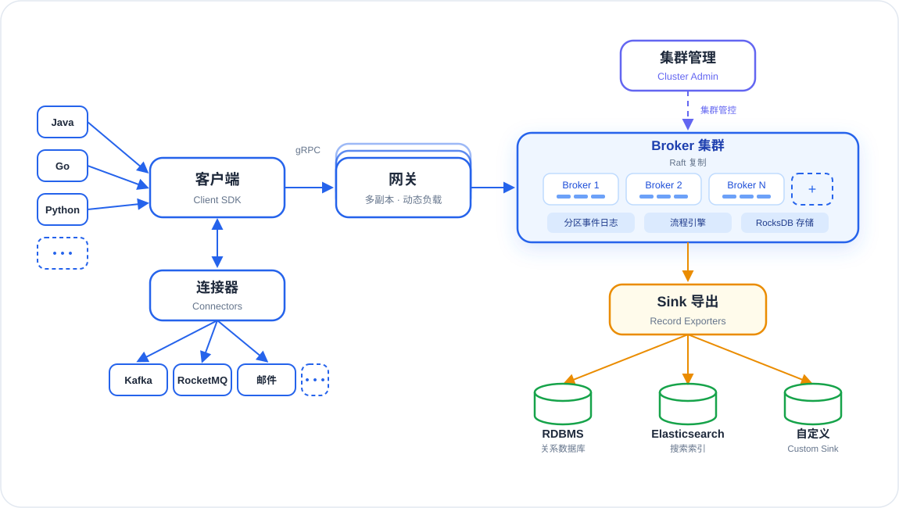

# README 首图设计规范（kunpeng-hero 面板）

> 画布基准 1150×650。本文所有坐标以左上角为原点，四文件通用（布局不变量）。

## 1. 风格基调

- **简单线条风**（用户 9 轮迭代定稿，参考 iShot BPMN 深底卡片风格）：2~2.5px 描边、直线实心箭头（marker 三角）、无多余装饰
- **唯一焦点**：Broker 集群面板是全图唯一带底色/光晕的焦点区域，其余框一律白/深底细描边
- **双语标签**：中文版 = 中文主标（大）+ 英文副标（小灰）；英文版 = 英文主标 + 英文副标
- **白底不用饱和渐变**：浅色版焦点面板是浅蓝底 + 描边（#EFF6FF/#2563EB），蓝渐变填充只在深底版（用户反馈白底渐变不协调）

## 2. 布局分区（四角原则）

- 主链在画面中层横向：语言列 → 客户端 → 网关 → Broker 集群
- 管理面在顶部、Sink 扇出在右下、连接器在左下——**内容分布四角，勿改成底部堆叠**

## 3. 元素坐标总表

| 元素 | 位置/尺寸 | 说明 |
|------|-----------|------|
| 底板 | (1,1) 1148×648 rx26 | 白版 #FFFFFF/#E2E8F0；深版 #0D1420 |
| 语言芯片 | x48 w64 h40 rx10，y=136/192/248；y=304 为虚线"⋯"(w64) | Java/Go/Python + 更多 |
| 语言汇入箭头 | (112,156)→(188,220)、(112,212)→(188,240)、(112,268)→(188,260) | 蓝实线 marker |
| 客户端框 | (192,202) 172×76 rx16 | 主标 y236，副标 y260 |
| gRPC 标签 | (394,196) 居中 | 箭头 (364,240)→(424,240) |
| 网关堆叠 | (430,184/193/202) 172×76 ×3，opacity 0.45/0.75/1 | 三层卡片=多副本；主标 y236 副标 y260 |
| 网关→Broker | (602,240)→(656,240) | |
| 集群管理框 | (794,52) 172×64 rx16 | 靛蓝系；主标 y80 副标 y102 |
| 管理虚线 | (880,116)→(880,164)，dasharray 7 6 | 标签"集群管控"(896,145) |
| Broker 焦点面板 | (662,170) 436×140 rx18 | 标题 y192，副标 y212；白版底 #EFF6FF + glow，深版 url(#focal) 渐变 + glow |
| 节点芯片 | y222 h40 w96 rx9：x=695/801/907 | Broker 1/2/N；文字 y241 |
| 扩容位 | (1013,222) 52×40 虚线 dasharray 6 5 | 中央"+"(1039,248) |
| 分区条 | 18×5 rx2 y249：x=712/734/756、818/840/862、924/946/968 | 每节点 3 条 |
| 能力芯片 | y272 h26 w112 rx7：x=700/824/948 | 分区事件日志/流程引擎/RocksDB 存储；文字 y289 |
| Sink 下行箭头 | (880,310)→(880,358) | 橙 |
| Sink 导出框 | (780,364) 200×64 rx16 | 主标 y392 副标 y415 |
| Sink 扇出 | (880,428)→(723,490)/(880,490)/(1037,490) | 橙 |
| 存储圆柱 | cx=720/880/1040，椭圆 cy502 rx36 ry11，柱体到 y532 | 绿描边；主标 y560、副标 y578 |
| 连接器框 | (192,346) 172×64 rx16 | 与客户端双向箭头 (278,282)→(278,340) marker 两端=job 拉取/回传 |
| 连接器扇出 | (278,410)→(177,462)/(259,462)/(341,462) | |
| 连接器芯片 | y466 h40：Kafka(140,w74)、RocketMQ(222,w74)、Email(304,w74)、⋯(386,w34 虚线) | |

## 4. 配色对照（浅色版 / 深色版）

| 用途 | 浅色版 | 深色版 |
|------|--------|--------|
| 主链蓝（框描边/箭头） | #2563EB | #3B82F6 |
| 框底 | #FFFFFF | #121C30 |
| 管理面（集群管理/虚线/标签） | #6366F1 | #93B4E8 |
| 焦点面板 | 底 #EFF6FF + 描边 #2563EB + glow(#3B82F6 18%) | url(#focal) #3B82F6→#1D4ED8 渐变 + glow(35%) |
| 节点芯片 | #FFFFFF / 描边 #BFDBFE 1.5 / 文字 #1D4ED8 | 底 #0B1730(45%) / 文字 #DBEAFE |
| 分区条 | #3B82F6 op .75 | #93B4E8 op .85 |
| 能力芯片 | 底 #DBEAFE / 文字 #1E3A8A | 底 #0B1730(40%) / 文字 #DBEAFE |
| Sink 橙（箭头/描边） | #EA8C00，框底 #FFFBEB | #F59E0B，框底 #1A1710 |
| 存储圆柱绿 | #16A34A | #22C55E |
| 主文字 | #1E293B | #F5F8FF |
| 副文字 | #64748B | #93B4E8 |

## 5. 字号阶梯

| 层级 | 字号 | 用途 |
|------|------|------|
| 主框名 | 19 | 客户端/网关 |
| 框名 | 18 | 连接器/集群管理/Sink 导出 |
| 焦点面板标题 | 17 | Broker 集群 |
| 圆柱主标 | 14.5 | RDBMS/Elasticsearch/自定义 |
| 芯片 | 13 | 语言/Kafka 等小框 |
| 副标/节点名 | 12.5 | 框内副标、Broker 1/2/N |
| 链路标签 | 12 | gRPC |
| 标签/能力芯片/圆柱副标 | 11.5 | 集群管控、Event log 等 |

## 6. 中英文案对照表（改文案两头同步）

| 中文版 | 英文版 |
|--------|--------|
| 连接器 / Connectors | Connectors / job integrations |
| 邮件 | Email |
| 客户端 / Client SDK | Client SDK / any language |
| 网关 / 多副本 · 动态负载 | Gateway / load-balanced replicas |
| 集群管理 / Cluster Admin | Cluster Admin / control plane |
| 集群管控 | cluster control |
| Broker 集群 / Raft 复制 | Broker cluster / Raft replication |
| 分区事件日志 | Event log |
| 流程引擎 | Process engine |
| RocksDB 存储 | RocksDB storage |
| Sink 导出 / Record Exporters | Sink export / Record Exporters |
| 关系数据库 | relational database |
| 搜索索引 | search index |
| 自定义 / Custom Sink | Custom / any RecordSink |

> "集群管控"用词定案（2026-10-12）：该虚线承载管理面全部下发（扩缩容、再平衡、分区/副本变更…），标签描述通道本身而非单项功能；此前"动态扩缩容/autoscaling"被否。

## 7. 审美红线（用户已否决项，勿再踩）

- ❌ 人形图标、拟物插画
- ❌ 内容底部堆叠（应四角分布）
- ❌ 调度/治理芯片化塞进主链
- ❌ 白底版用饱和渐变填充
- ❌ 复杂连线（交叉、折线绕行）
- ✅ 间距宁松勿挤；照用户给定路线画；极简优先

## 8. 口径备注

- 连接器扇出按**能力级**画（Kafka/RocketMQ/邮件/⋯），与 Sink 画 Elasticsearch 同口径——仓库 connector/ 实际仅保留 rest+script 源码，kafka 等为上游生态件
- 语言列 Java/Go/Python 为多语言系统示意，"⋯"虚线位表达可扩展
