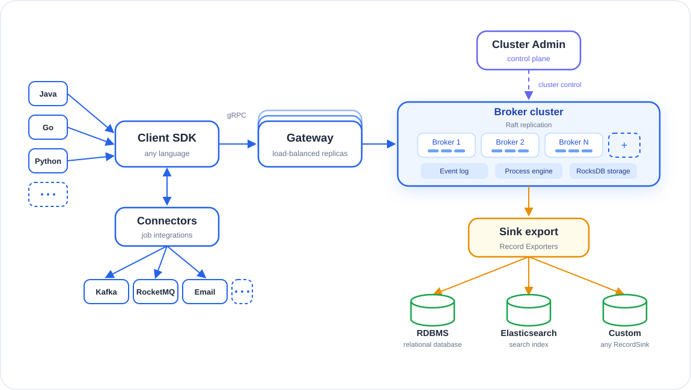

# Engine for Microservices Orchestration

English | [简体中文](README.zh-CN.md)

Kunpeng provides visibility into and control over business processes that span multiple microservices.

## How it works

<picture>
  <source media="(prefers-color-scheme: dark)" srcset="docs/kunpeng-hero-dark-en.svg">
  
</picture>

Clients spread load dynamically across stateless gateways, which route each request to the leading partition of a Raft group. There the BPMN 2.0 engine executes processes and appends every step to the partition's event log; the same log fans out through multiple sinks into multiple external stores — resumable, and off the execution path. On the client side, a connector runtime hosts integrations as job workers: REST and script connectors out of the box, extensible via the SDK to Kafka, RocketMQ, email, and more.

**Why Kunpeng?**

* Define processes visually in [BPMN 2.0](https://www.omg.org/spec/BPMN/2.0.2/)
* Choose your programming language
* Deploy with [Docker](https://www.docker.com/) and [Kubernetes](https://kubernetes.io/)
* Build processes that react to messages from [Kafka](https://kafka.apache.org/) and other message queues
* Scale horizontally to handle very high throughput
* Fault tolerance (no relational database required)
* Export process data for monitoring and analysis
* Engage with an active community

## Helpful Links

* [Documentation Home](./docs)
* [Getting Started: startup forms & port model](./docs/user-guide/getting-started.md)
* [Distribution & Deployment](./dist/README.md)
* [Java Client SDK](./clients/client-java)
* [Cluster Messaging Benchmarks](./docs/cluster-messaging-benchmark.md)

## Star History

## Licenses

The repository is multi-licensed with **GNU-AGPL-3.0 as the default**: unless a directory is explicitly designated otherwise, all code is licensed under GNU-AGPL-3.0. A few directories use Apache-2.0 or MPL-2.0 instead — licensing follows the directory, so externally imported files without a header still fall under the license of the directory they live in. Full license texts are kept under [`licenses/`](./licenses/).

### 1. Use License

1. [APACHE-2.0](./licenses/APACHE-2.0.txt)
2. [GNU-AGPL-3.0](./licenses/GNU-AGPL-3.0.txt)
3. [MPL 2.0](./licenses/MPL-2.0.txt)

### 2. License Notice

1. The license of each directory is designated by this project; see [`licenses/`](./licenses) for the full texts. File headers only carry copyright attribution.
2. Please do not touch the copyright headers, we need to keep their copyright on their files. On new files we create, we
   will have our License headers with our copyright.
3. Where agreement compatibility permits, most of the files have been added with our own copyright header(We made
   extensive adjustments to the file to allow for quick iteration).

### 3. License Compliance Feedback

This repository incorporates and adapts multiple upstream projects. We make good-faith efforts to comply with every upstream license, but unintended violations may still exist (e.g., missing attribution or mis-designated licensing).

If you find a license violation, copyright misattribution, or any other compliance concern, please reach out:

1. Open a [GitHub Issue](https://github.com/anyilanxin/kunpeng-engine/issues/new)
2. Email anyilanxin@aliyun.com

We commit to verifying every report promptly and, once confirmed, fixing it within a reasonable timeframe (fixing attribution, re-designating the license, or removing the code) with the outcome published on the issue.
